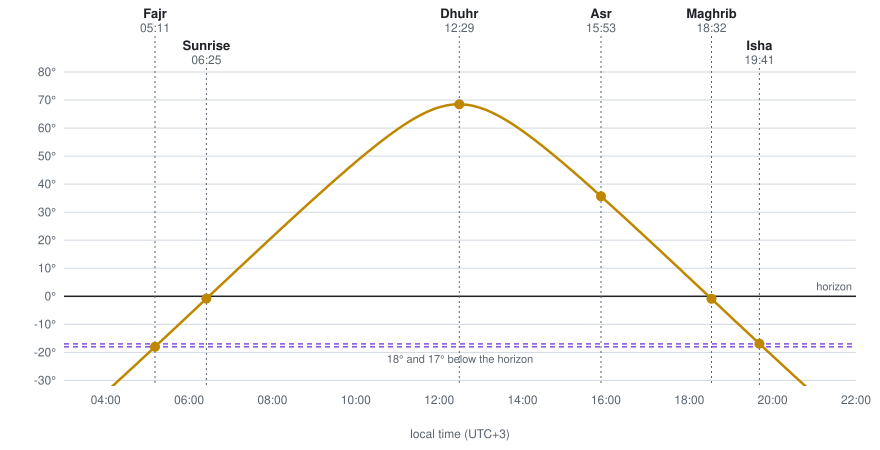
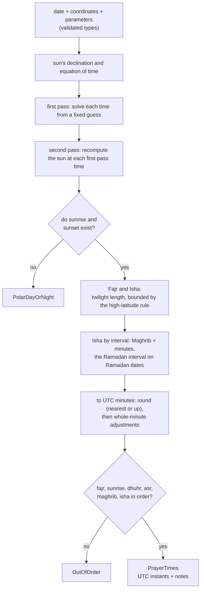
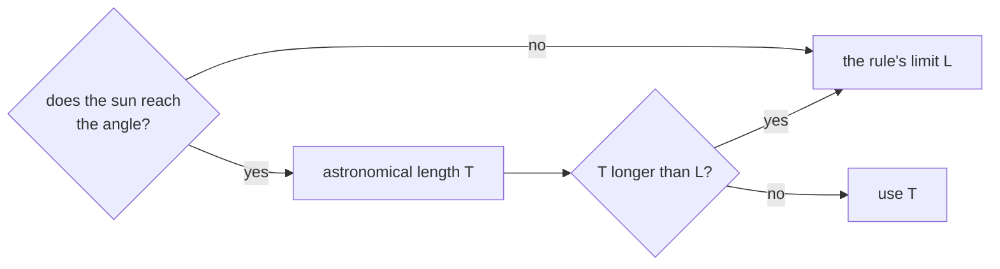
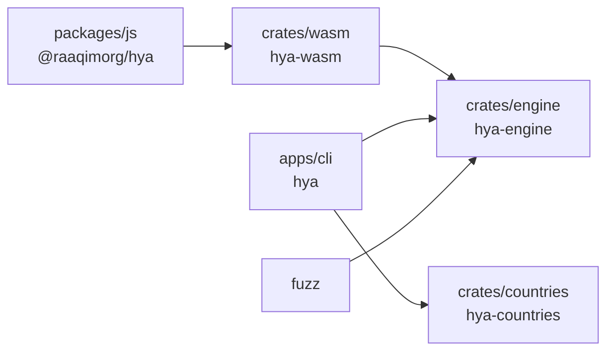

<h1 align="center">Hya <sub dir="rtl">حَيَّ</sub></h1>

<p align="center" dir="rtl"><b>مواقيت الصلوات الخمس، بلا اتصال</b></p>
<p align="center">The five daily prayer times, offline</p>

<p align="center">
  <a href="LICENSE"></a>
  
  
</p>

Hya computes Islamic prayer times from a place and a date. Its name comes from the call of the adhan, *ḥayya ʿalā ṣ-ṣalāh*: "come to the prayer". It needs no network, no API key, and no data download, so it works on a plane, in a browser tab, on a server, or inside an app. The calculation is one pure Rust function. Hya ships it as a Rust library, a JavaScript package with the WebAssembly inlined, and a command-line tool. Where an authority publishes its own timetable, Hya is tested against that timetable, not against another library. [Contributions are welcome](#contributing).

| Methods | Countries | Official timetables tested |     Years | Golden cases | Kani proofs |
| ------: | --------: | -------------------------: | --------: | -----------: | ----------: |
|      15 |        11 |                          4 | 1900–2100 |          528 |          14 |

<sub>Countries counts those whose own authority uses one of the methods (see <a href="#countries">Countries</a>). The four timetables are Umm al-Qura, MUIS (Singapore), JAKIM (Malaysia), and the Ministry of Awqaf (Jordan).</sub>

## Try it

**In the terminal.** The first run asks for your place. Hya saves it, so after that `hya` alone prints today's times:

```console
$ hya --lat 24.7136 --lng 46.6753 --tz Asia/Riyadh
2026-10-29  umm_al_qura  (Asia/Riyadh)
  fajr     04:40
  sunrise  05:58
  dhuhr    11:38
  asr      14:51
  maghrib  17:16
  isha     18:46
```

`--method` picks a method, and `--country JO` picks the method of that country's own authority. `--clock 12` prints 6:45 PM instead of 18:45. A flag applies to that run only; add `--save` to keep it as a default. The times go to stdout and notes to stderr, so `hya | …` gets only the times.

**In JavaScript.** The package has no async start-up and no network request. It returns `Date`s:

```ts
import { latitude, longitude, prayerTimes } from "@raaqimorg/hya";

const times = prayerTimes(
  { year: 2026, month: 10, day: 29 },
  { latitude: latitude(24.7136), longitude: longitude(46.6753) },
  { method: "umm_al_qura" },
);
times.fajr; // Date: 2026-10-29T01:40:00Z, 04:40 in Riyadh
```

Pass `timeZone: "Asia/Riyadh"` when the date is a civil date in a known zone. It matters only in the far Pacific (see [edge cases](#edge-cases-and-how-hya-handles-them)).

**In Rust.** The core is `no_std`, and it does not allocate:

```rust
use hya_engine::{compute, Coordinates, Date, Parameters};

let riyadh = Coordinates::new(24.7136, 46.6753)?;
let times = compute(Date::new(2026, 10, 29)?, riyadh, Parameters::default())?;
assert!(times.fajr() < times.sunrise());
```

**From source.** None of the three is published yet. You need [rustup](https://rustup.rs) and [Bun](https://bun.sh) 1.4 or later:

```bash
git clone https://github.com/raaqimorg/hya.git
cd hya
bun install
cargo run -p hya-cli -- --lat 24.7136 --lng 46.6753 --tz Asia/Riyadh
```

`rust-toolchain.toml` pins the Rust version, and rustup installs it on the first build.

## How prayer times are calculated

Each prayer begins at a moment that the sun defines. Five of the six daily times are set by the sun's height above or below the horizon. Dhuhr is set by its highest point.

<p align="center">
  
</p>

<p align="center"><sub>Makkah, 20 March 2026, Muslim World League method. The curve is the sun's altitude, from Hya's own solar model.</sub></p>

| Time    | Begins when                                                                       | Set by                        |
| ------- | --------------------------------------------------------------------------------- | ----------------------------- |
| Fajr    | the first light of dawn: the sun is a set angle below the horizon, 15° to 20°     | the method's Fajr angle       |
| Sunrise | the sun's upper edge clears the horizon (Fajr's time ends)                        | refraction and the sun's size |
| Dhuhr   | the sun has passed its highest point                                              | the meridian                  |
| Asr     | a stick's shadow is its length plus its noon shadow (twice its length, Hanafi)    | the school of law             |
| Maghrib | the sun's upper edge sets                                                         | refraction and the sun's size |
| Isha    | the twilight is gone: the sun is a set angle below, or a fixed time after Maghrib | the method                    |

So the calculation has two steps: find where the sun is, then solve for the moments when it reaches each height.

**1. Where the sun is.** For a day, two quantities are enough: the sun's *declination* $\delta$, which is how far north or south of the equator it stands, and the *equation of time* $E$, which is how far the real sun runs ahead of or behind a clock. Hya uses the U.S. Naval Observatory's low-precision formulas. They are accurate to about a minute of time between 1900 and 2100, which is the precision that timetables are published at.

**2. When the sun is at a height.** Solar noon, the moment when the sun crosses the meridian, comes first. At longitude $\lambda$ (degrees east), in hours of UTC:

$$\text{noon} = 12 - \frac{\lambda}{15} - E$$

For any altitude $h$ (negative below the horizon), at latitude $\varphi$, the sun's *hour angle* $H$ is how far it is from noon:

$$\cos H = \frac{\sin h - \sin\varphi \, \sin\delta}{\cos\varphi \, \cos\delta}$$

Then the time is $\text{noon} - H/15$ in the morning, and $\text{noon} + H/15$ in the evening. If the right-hand side is outside $[-1, 1]$, the sun never reaches that altitude on that day. That case is the root of most of the [edge cases](#edge-cases-and-how-hya-handles-them).

Each time then needs its altitude:

- **Sunrise and sunset:** $h = -0.833°$. That is 34′ of atmospheric refraction plus 16′ for the sun's radius, because the sun's upper edge sets, not its centre. From a height of $e$ metres, the horizon dips further, by $0.0347\sqrt{e}$ degrees.
- **Fajr and Isha:** $h = -\alpha$, where $\alpha$ is the method's angle.
- **Asr:** the shadow condition gives the altitude directly. With a shadow factor $k$ of 1 (standard) or 2 (Hanafi):

$$h_\text{Asr} = \operatorname{arccot}\big(k + \tan\lvert\varphi - \delta\rvert\big)$$

- **Night marks:** the night runs from sunset to the next sunrise. Midnight is halfway through it, and the last third begins two thirds of the way through.

## How Hya does it



**The core is a pure function.** `compute(date, coordinates, parameters)` returns `Result<PrayerTimes, ComputeError>`. It never reads a clock, a file, the network, a time zone database, or a global. The date is an input, so the caller decides what "today" is. The results are UTC instants, and turning them into a local wall-clock time is the caller's job: the CLI uses `jiff`, and the JS package returns `Date`s. The same inputs give the same outputs on every platform, because the maths is `libm`, not the platform's.

**Two passes, not one.** The sun moves during the day, so its position at noon is not its position at dawn. The first pass solves every time with the sun's position at a fixed guess (5:00 for Fajr, 18:00 for Isha, and so on). The second pass recomputes the sun at each first-pass time and solves again. The error after the second pass is far below a minute.

**A method is only a preset.** One engine computes every method. A method is a set of `Parameters`: the Fajr angle, an Isha angle or interval, the Asr factor, the Dhuhr and Maghrib rules, the high-latitude rule, the rounding, and minute adjustments. Any parameter can be changed, and a method is just a named starting point.

**Only the place is required.** Everything else has a default:

| Setting            | Default                                                                      |
| ------------------ | ---------------------------------------------------------------------------- |
| Method             | Umm al-Qura: Fajr 18.5°, Isha 90 minutes after Maghrib, 120 in Ramadan       |
| Asr                | Standard (shadow factor 1)                                                   |
| High-latitude rule | Recommended: a seventh of the night above 48°, the middle of the night below |
| Elevation          | Sea level                                                                    |

**Invalid states cannot be represented.** `Latitude`, `Longitude`, `Elevation`, `TwilightAngle`, `IshaInterval`, `MinuteAdjustment`, and `Date` have private fields. The only way to make one is a constructor that rejects NaN, infinity, and out-of-range values. Errors are typed enums, never strings or panics. A `PrayerTimes` value can only come from `compute`, so its times are always in daily order. The JS package mirrors this with branded `number`s.

## Edge cases and how Hya handles them

<details open>
<summary><b>Short nights: Fajr and Isha that never come</b></summary>
<br>

North of about 48°, the summer sun does not sink 18° below the horizon. Twilight lasts all night, so an angle-based Fajr or Isha has no solution. Even before that point, the astronomical times can crowd into a night that is only a few hours long.

Hya computes each twilight as a *length* (Fajr to sunrise, or sunset to Isha), then bounds it with the method's high-latitude rule:



| Rule                  | Limit L                                                                                                |
| --------------------- | ------------------------------------------------------------------------------------------------------ |
| Recommended (default) | a seventh of the night above 48°, half of it below                                                     |
| Middle of the night   | half of the night                                                                                      |
| Seventh of the night  | a seventh of the night                                                                                 |
| Twilight angle        | angle ÷ 60 of the night (18° gives 18/60)                                                              |
| Season-adjusted       | the Moonsighting Committee's table of minutes, by season and latitude; a seventh of the night from 55° |
| None                  | no limit: a time that does not occur is an error, `Undefined(Fajr)` or `Undefined(Isha)`               |

When a rule sets a time, the result says so: `notes().fajr_high_latitude` and `notes().isha_high_latitude`. An app can show that the time is a substitute, not an observation.

</details>

<details>
<summary><b>Polar day and polar night</b></summary>
<br>

Above the Arctic and Antarctic circles, there are days when the sun does not rise or does not set. There is no night to divide, so no rule can give a Fajr. `compute` returns `ComputeError::PolarDayOrNight`, and the CLI prints "the sun does not rise or set on this day". Hya does not invent times from a different place or a different day. That choice belongs to the user and to their local authority.

</details>

<details>
<summary><b>Ramadan changes Isha in Umm al-Qura</b></summary>
<br>

Umm al-Qura's Isha is 90 minutes after Maghrib, and 120 in Ramadan. So the times depend on the Islamic calendar, and Hya carries it offline. `ramadan_table.rs` holds the first and last day of every Ramadan from 1900 to 2100 (208 entries). It is generated from ICU's `islamic-umalqura` calendar, and CI checks that it is unchanged (`bun run ramadan:check`).

The longer Isha applies by *calendar date*, as the official timetable and the Saudi Ministry of Islamic Affairs apply it. Every day of Ramadan, including its last (the eve of Eid), gets 120 minutes. The eve of 1 Ramadan gets 90, because the moon sighting is announced after Maghrib. `notes().ramadan_isha` reports which interval was used.

</details>

<details>
<summary><b>The moon sighting can move Ramadan by a day</b></summary>
<br>

The real month begins on the sighting, which can be a day off the calculated calendar. A caller that knows the announced dates passes them: `AnnouncedRamadan::new(first, last)` in Rust, the `ramadan` option in JS, or `--ramadan 2026-02-19..2026-03-20` in the CLI. An announcement must span 29 or 30 days and start within 3 days of the calendar. So a typo, such as the wrong year, is an error, not a silently moved Isha. It replaces only the month that it overlaps, and every other year stays calculated.

</details>

<details>
<summary><b>Rounding: the same instant, a different minute</b></summary>
<br>

Timetables are published to the minute, and authorities round differently. Most libraries, and most methods, round to the nearest minute. Umm al-Qura, JAKIM, and MUIS round *up*, so that a prayer is never announced before its time. They round sunrise *down*, so that the end of Fajr is never announced late. Rounding to the nearest minute matches only about half of Umm al-Qura's official times. With the authority's rounding, 88–89% match exactly.

Rounding happens once, on the UTC minute. Minute adjustments come after it, so an adjustment of +3 always moves a time by exactly 3 minutes.

</details>

<details>
<summary><b>When does Dhuhr begin?</b></summary>
<br>

Astronomically, the sun crosses the meridian at noon. But Dhuhr begins once the sun has *passed* it. Most methods add a minute to noon. JAKIM waits until the sun's whole disc has crossed, which is 64 seconds after its centre. Malaysia's timetables match that on 98% of days. Hya has both rules: `DhuhrRule::Transit` with an adjustment, and `DhuhrRule::AfterTheLimb`.

</details>

<details>
<summary><b>Asr's noon shadow</b></summary>
<br>

Asr compares a shadow with the shadow at noon, so the noon shadow must use the sun's declination *at noon*. Some libraries take it at 0h UT. In winter, above 50°, that puts Asr up to about 2 minutes off. Hya evaluates the declination at the transit, and a test checks Asr against the literal shadow definition, solved with an independent solar model, to within 0.6 minutes.

</details>

<details>
<summary><b>Elevation, time zones, and the date line</b></summary>
<br>

- **Elevation** lowers the horizon, so the sun rises earlier and sets later. Hya applies it to sunrise and sunset only. It does not apply it to Fajr and Isha, whose angles are measured from the true horizon.
- **Time zones** never enter the core. A time near midnight can fall on the previous or next UTC day. A local wall-clock time, with daylight saving and historical zone changes, is the formatter's job, given the IANA zone.
- **The date is the solar day.** `compute` takes the day whose solar noon is Dhuhr at that longitude. Almost everywhere, that is the civil date. But Samoa and Tonga keep UTC+13, and Kiribati UTC+14, while the sun there runs about 11 hours *behind* UTC. Their civil 30 October is the solar 29th. Passing the civil date straight in would give the next day's times. The CLI and the JS package's `timeZone` option fix this: they take the neighbouring solar day whose Dhuhr falls on the civil date in that zone.

</details>

<details>
<summary><b>Tehran's Maghrib on short summer nights</b></summary>
<br>

Tehran's method starts Maghrib when the sun is 4.5° below the horizon, not at sunset. In a Nordic summer, the high-latitude rule can put Isha within minutes of sunset, so the 4.5° Maghrib would come *after* Isha. In Oslo, that happens for about seven weeks a year. As adhan-js does, Hya then keeps Maghrib at sunset, and reports it in `notes().maghrib_at_sunset`.

</details>

<details>
<summary><b>Adjustments that break the order</b></summary>
<br>

Any time can be moved by a whole number of minutes, from −120 to +120. A large adjustment on a short night can push Isha past midnight, or Maghrib past Isha. Hya checks the order after every adjustment. It returns `ComputeError::OutOfOrder`, not a schedule where Isha comes before Maghrib.

</details>

<details>
<summary><b>Inputs out of range</b></summary>
<br>

A latitude of 91°, a NaN longitude, a 31 February, a year outside 1900–2100, or a Fajr angle of 0° (angles must be 0.5° to 30°) cannot reach the calculation. The constructors reject them with `InvalidInput`, and Kani proves that the integer and date code cannot panic or overflow for *any* input.

</details>

## Methods

| Method                   | ID                       | Fajr  | Isha                       | Notes                                                       | Checked against           |
| ------------------------ | ------------------------ | ----: | -------------------------- | ----------------------------------------------------------- | ------------------------- |
| Umm al-Qura (default)    | `umm_al_qura`            | 18.5° | 90 min; 120 in Ramadan     | rounds up, sunrise down                                     | **official calculator**   |
| Muslim World League      | `muslim_world_league`    |   18° | 17°                        |                                                             | adhan-js                  |
| Egyptian                 | `egyptian`               | 19.5° | 17.5°                      |                                                             | adhan-js                  |
| Karachi                  | `karachi`                |   18° | 18°                        |                                                             | adhan-js                  |
| ISNA (North America)     | `north_america`          |   15° | 15°                        |                                                             | adhan-js                  |
| Dubai                    | `dubai`                  | 18.2° | 18.2°                      | sunrise −3, Dhuhr, Asr, Maghrib +3                          | adhan-js                  |
| Kuwait                   | `kuwait`                 |   18° | 17.5°                      |                                                             | adhan-js                  |
| Qatar                    | `qatar`                  |   18° | 90 min                     |                                                             | adhan-js                  |
| Singapore (MUIS)         | `singapore`              |   20° | 18°                        | rounds up                                                   | **MUIS timetable**        |
| Türkiye (Diyanet)        | `turkey`                 |   18° | 17°                        | sunrise −7, Dhuhr +5, Asr +4, Maghrib +7                    | adhan-js; Diyanet locally |
| Tehran                   | `tehran`                 | 17.7° | 14°                        | Maghrib at 4.5°                                             | adhan-js                  |
| Moonsighting Committee   | `moonsighting_committee` |   18° | 18°                        | season-adjusted twilight; Dhuhr +5, Maghrib +3              | adhan-js                  |
| Malaysia (JAKIM)         | `malaysia`               |   18° | 18°                        | Dhuhr after the limb, rounds up, sunrise down               | **JAKIM e-solat**         |
| Malaysia, Kelantan       | `malaysia_kelantan`      |   18° | 17°                        | as Malaysia                                                 | **JAKIM e-solat**         |
| Jordan (Awqaf)           | `jordan`                 |   18° | 18°                        | sunrise −7, Maghrib +6                                      | **Ministry of Awqaf**     |

Isha can follow the red twilight (Shafiʿi, Maliki, Hanbali), the white (Hanafi), or the Moonsighting Committee's blend of the two (the default) with the season-adjusted rule. Any method can use any high-latitude rule.

<details>
<summary><b>How each official check was done</b></summary>
<br>

- **Umm al-Qura.** The official calculator behind ummulqura.org.sa computes times for any coordinates. The fixture holds all of 2026 for Makkah, Riyadh, and Tabuk. With the authority's rounding, 88–89% of times are exact to the minute, and every time is within 2 minutes. Isha is 120 minutes after Maghrib on exactly the calendar's 30 days of Ramadan 1447, and 90 on every other day.
- **Singapore.** MUIS publishes one timetable for the island, on data.gov.sg under an open licence, and does not say which point it computes for. At the best-fitting point (1.28°N, 103.82°E), every time on every day of 2026 is within a minute, and 73% are exact.
- **Malaysia.** JAKIM computes each zone at one reference point. Wilayah Persekutuan publishes its points. At those points, every time on every day of 2026 is within 2 minutes, and 72–98% are exact. Fajr is 18° (it moved from 20° in 2019). Kelantan uses 17° for Isha in every zone, about 4 minutes earlier, so it has its own preset. The Isha angle is also checked in all 55 lowland zones. Highland zones (Cameron Highlands, Genting, Bukit Larut, Kundasang) use their elevation and are not covered.
- **Jordan.** The Ministry of Awqaf publishes from the current day to 31 December, so the fixture covers 30 October to 31 December 2026 for Amman, Irbid, and Aqaba. Its reference points are not published, so the test measures every time from Dhuhr, which cancels longitude. Fajr, Asr, and Isha are within 2 minutes every day in all three cities, and a degree either way (Fajr 19°, Isha 17°) fails. The ministry gives each region its own sunrise and Maghrib margin. The preset uses Amman's, which elsewhere is up to 5 minutes more cautious, never less.
- **Türkiye.** Compared with Diyanet's published Istanbul timetable for 396 days: every time is within 2 minutes. Diyanet publishes its times only on its own site and through an API that needs registration, so there is no committed fixture and no test in CI.

</details>

<details>
<summary><b>Methods left out, and why</b></summary>
<br>

A method is added only when its parameters reproduce the authority's own published times. Figures that only circulate on third-party sites are not enough. As of October 2026:

- **Russia (DUM RF).** Its Moscow timetables fit Fajr 18° and Isha 15° (not the widely quoted 16° and 15°), with sunrise −5, Dhuhr +5, and Maghrib +5 minutes. But from May to July, Isha moves between two rules along a curve that no rule tried here reproduces, up to 21 minutes off. The preset would be wrong for a quarter of the year.
- **France (UOIF, Musulmans de France, 12°).** No timetable from the organisation itself was found, and its former domain now redirects elsewhere. The 12° figure comes only from third parties.
- **Indonesia and Morocco.** Their authorities' methods are not implemented yet.

</details>

### Countries

`hya-countries` maps an ISO 3166-1 country code to a method, but only where the method is the country's own authority's: Saudi Arabia, Egypt, Pakistan, the UAE, Kuwait, Qatar, Singapore, Türkiye, Iran, Malaysia, and Jordan. Each entry names its authority. Everywhere else it returns `None`. In the UK and North America, the custom is split between several methods. In Indonesia, Morocco, and Russia, the authority's method is not implemented. A guess there would be silently wrong for many people. So the CLI refuses an unlisted country with `--country`, and asks for `--method`.

## Verification

Prayer times are a matter of worship, so a wrong minute matters. Hya is checked in several independent ways:

| Technique           | What it covers                                                                                                                                              | Where                                                                                   |
| ------------------- | ----------------------------------------------------------------------------------------------------------------------------------------------------------- | --------------------------------------------------------------------------------------- |
| Official timetables | Umm al-Qura, MUIS, JAKIM, and Awqaf Jordan, as described in [Methods](#methods)                                                                             | `crates/engine/tests/official.rs`, `fixtures/official/`                                 |
| Golden tests        | 528 city, date, and method cases against adhan-js 4.4.4, within 1 minute: all three shafaqs, above 55°, southern hemisphere                                 | `crates/engine/tests/golden.rs`, JS tests                                               |
| Exact Asr           | 384 cases, 0–60° in both hemispheres, both schools, against the literal shadow definition: within 0.6 minutes                                               | `crates/engine/tests/asr_reference.rs`                                                  |
| Property-based      | 19 invariants: daily order, totality below 55°, exact validation, determinism, season-adjusted twilight only shortens, an announced Ramadan only moves Isha | `crates/engine/tests/properties.rs` (2,000 cases in CI; 1,000,000 in `deep:properties`) |
| Metamorphic         | Adjustments shift exactly; Hanafi Asr is later; a deeper Fajr angle is never later; 1° of longitude is 4 minutes of noon                                    | `crates/engine/tests/properties.rs`                                                     |
| Sequential          | Day-by-day walks: bounded daily drift; the Ramadan flag flips exactly at the table's boundaries over 10 years                                               | `crates/engine/tests/calendar_walk.rs`                                                  |
| Model-based         | Random operation sequences on the CLI's config store against a reference model, shrunk on failure                                                           | `apps/cli/src/config.rs` (`state_machine`)                                              |
| Concurrency         | `Send + Sync` asserted at compile time; parallel results equal sequential ones                                                                              | `crates/engine/tests/concurrency.rs`                                                    |
| Mutation testing    | Every mutant of the core and of `hya-countries` is caught or does not compile; none is missed                                                               | `bun run deep:mutants`                                                                  |
| Formal verification | Kani: the integer and date code cannot panic or overflow for any input; country codes parse exactly two ASCII letters, and lookup is total                  | `src/verification.rs` in each crate                                                     |
| Fuzzing             | libFuzzer over arbitrary bytes, with overflow checks on                                                                                                     | `fuzz/`                                                                                 |
| Lints               | `unsafe` forbidden; clippy pedantic and restriction lints: no `as`, no unchecked arithmetic, no indexing, no float `==`, no `#[allow]`                      | `Cargo.toml`                                                                            |
| JS properties       | fast-check over the compiled WebAssembly, including "only `PrayerTimesError` ever escapes"                                                                  | `packages/js/test/`                                                                     |

<details>
<summary><b>Honest limits</b></summary>
<br>

- **Floating-point astronomy cannot be proven correct.** Kani proves the integer and date logic for all inputs: calendar conversion, the Ramadan lookup, announcement validation, the bounded types, and instant conversion. The trigonometry is covered by golden, property, and metamorphic tests, not by proofs.
- **Most methods are checked against adhan-js, not against their authority.** Egypt, Karachi, ISNA, Dubai, Kuwait, Qatar, Tehran, Türkiye, and the Moonsighting Committee are not yet checked against an official timetable. Jordan's check covers only the last two months of 2026.
- **adhan-js is not an observatory either.** Agreement with it within a minute is the bar that the major apps use. Where adhan is off, as with its winter Asr above 50°, Asr is checked against the exact definition instead.
- **Umm al-Qura is a published calendar.** The table reproduces ICU's copy of it. An official correction needs the table to be regenerated.
- **Miri and loom add little here.** There is no `unsafe` code for Miri to check, and no shared mutable state for loom. The concurrency tests guard against that changing.
- **Asr near the polar circles.** When the noon sun barely clears the horizon (above about 66.5°, a week or so before and after polar night), the Asr shadow condition is met only at noon itself. `compute` then returns `Undefined(Asr)` for the whole day, as it does for polar night.
- **Ramadan by solar day.** The Ramadan interval is chosen by the date passed to `compute`. In the UTC+13 and UTC+14 zones, that is the solar day, a civil day behind, so the 120-minute Isha starts and ends one evening late there.
- **Dates are limited to 1900–2100**, the range of the Ramadan table and of the solar model's accuracy.

</details>

## Layout



| Part                                              | Role                                                                                        | Built with              |
| ------------------------------------------------- | ------------------------------------------------------------------------------------------- | ----------------------- |
| [`crates/engine`](crates/engine/src/lib.rs)       | The calculation: pure, `no_std`, no I/O, no clock, no allocation                            | Rust, libm              |
| [`crates/countries`](crates/countries/src/lib.rs) | Country to method, where the country's own authority has one                                | Rust, `no_std`          |
| [`crates/wasm`](crates/wasm/src/lib.rs)           | WebAssembly bindings: numbers in, numbers out                                               | Rust, wasm-bindgen      |
| [`packages/js`](packages/js/src/index.ts)         | `@raaqimorg/hya`: the TypeScript API, with the WebAssembly inlined and branded inputs       | TypeScript, Bun         |
| [`apps/cli`](apps/cli/src/main.rs)                | `hya`: prints the day's times; asks for your place once, and `--save` keeps defaults        | Rust, clap, jiff        |
| [`fuzz/`](fuzz/fuzz_targets/compute.rs)           | cargo-fuzz target, in its own workspace                                                     | Rust nightly, libFuzzer |
| [`fixtures/`](fixtures/)                          | adhan-js reference outputs; `official/` holds the authorities' own timetables               | JSON                    |
| [`scripts/`](scripts/)                            | Fixture and Ramadan-table generators, the official-timetable fetcher, and the release check | Bun                     |

## Contributing

Report bugs and ideas in [GitHub issues](https://github.com/raaqimorg/hya/issues). If a time is wrong for your city, use the **Timetable mismatch** form, with a link to the authority's own timetable. To change code, do these steps:

1. Open an issue.
2. Fork the repo, and branch off `main`.
3. Run `bun run ci`.
4. Open a pull request into `main`, linked to the issue.

[`CONTRIBUTING.md`](.github/CONTRIBUTING.md) gives the full steps, including how to add a method. Good places to start are official timetables for the methods that are not yet checked, and the methods that are left out.

<details>
<summary><b>Commands</b></summary>
<br>

```bash
# Fast: what CI runs on every push and pull request
bun run ci                 # format, clippy, Rust tests, no_std build, Ramadan check, JS build, types and tests
bun run rust:test          # all Rust tests
bun run rust:lint          # clippy, strict

# Deep: slow, on demand, never in CI (also: Actions -> deep -> Run workflow)
bun run deep               # everything below except coverage; run it before a release
bun run deep:properties    # 1,000,000 cases per property
bun run deep:mutants       # mutation testing; add -- -f <file> for one file
bun run deep:kani          # formal verification (needs `cargo install kani-verifier && cargo kani setup`)
bun run deep:fuzz          # 10 minutes of fuzzing; FUZZ_SECONDS changes it (needs nightly and cargo-fuzz)
bun run deep:coverage      # HTML coverage report (needs cargo-llvm-cov)

bun run fixtures           # regenerate the adhan-js fixtures
bun run fixtures:official  # download the official timetables again (network; review the diff)
bun run release:check 0.2.0 # before a tag: every version and the changelog agree
cargo run -p hya-cli -- --method moonsighting_committee --shafaq red --save   # keep as defaults
cargo run -p hya-cli -- --country MY                                          # Malaysia's own authority's method
```

</details>

## License

The code and documentation are released under the [MIT license](LICENSE). The code of conduct is adapted from the [Contributor Covenant](https://www.contributor-covenant.org) 2.1. The golden fixtures are generated with [adhan-js](https://github.com/batoulapps/adhan-js) (MIT). The Singapore timetable is from data.gov.sg under the [Singapore Open Data Licence](https://data.gov.sg/open-data-licence). Hya is maintained by [Raaqim](https://raaqim.org) and its contributors.

<br>

<p align="center" dir="rtl">إِنَّ الصَّلَاةَ كَانَتْ عَلَى الْمُؤْمِنِينَ كِتَابًا مَّوْقُوتًا<br><sub>النساء ١٠٣</sub></p>
