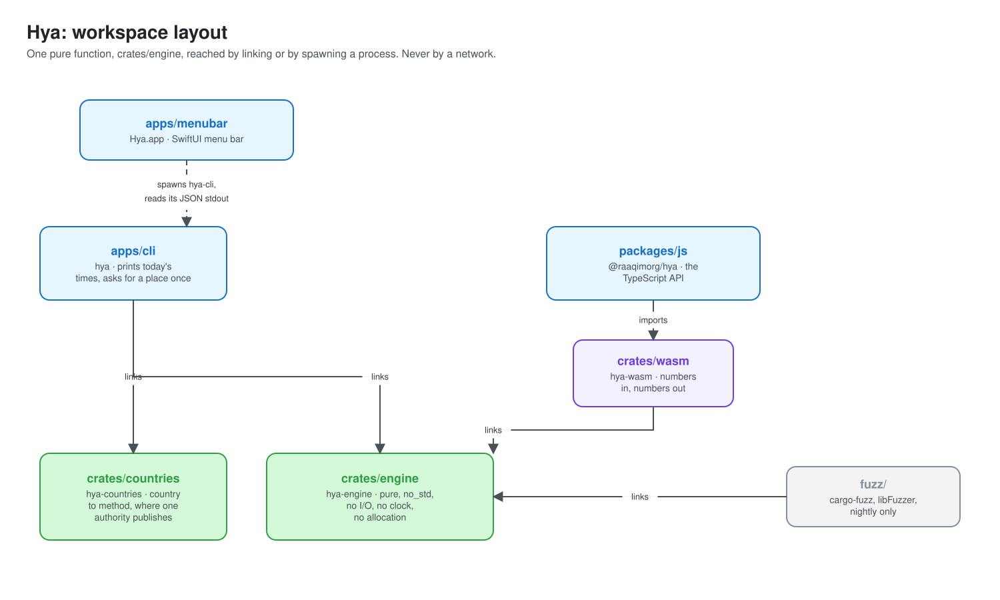
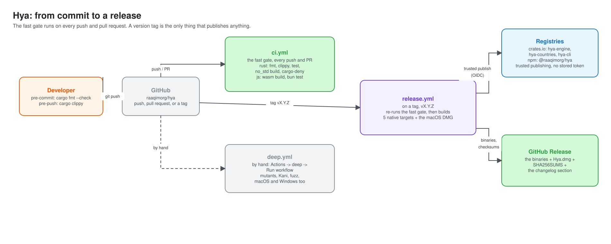

# Topology

This is a diagram-first map of the whole system: what links to what, what is a separate process, and how a release reaches a registry. Each section links to the doc with the details.

The diagrams are plain SVG files in `docs/architecture/`, in the same hand-drawn-free, Open Color style throughout. There is no renderer to run: open the `.svg` directly, or view it here, since GitHub renders it inline. To change one, edit its dimensions and text by hand (they are short and flat; see the top of each file for the shared marker and palette).

> There is no `system.svg` here, and no deployment diagram. Hya has no server, no database, and no network call anywhere in its own code (the `network: none` badge in the README is not a boast, it is a constraint the lints and the tests hold it to). The only topology worth drawing is **what gets linked into what**, and **what gets spawned as a process**. That is what the two diagrams below show.

## Workspace layout

- `crates/engine` (`hya-engine`) is the one pure function: `compute(date, coordinates, parameters)`. It is `no_std`, does no I/O, and reads no clock. `crates/countries` (`hya-countries`) is a smaller, separate pure function: country code to method, where one exists.
- Three things link `crates/engine` directly, as a normal Rust dependency, into their own binary: `apps/cli` (which also links `crates/countries`, for `--country`), `fuzz/` (which runs it through libFuzzer), and `crates/wasm`, which does nothing but turn the same function into WebAssembly: numbers in, numbers out.
- `packages/js` (`@raaqimorg/hya`) imports the compiled WebAssembly instead of linking Rust. It is the only door written in another language, and it carries the same validated-input, validated-output contract: the TypeScript types are branded the same way the Rust types are.
- `apps/menubar` (`Hya.app`, SwiftUI) does not link anything. It is the one consumer across a process boundary: it spawns the `hya-cli` binary it bundles, passes `--json --lat --lng`, and decodes the one line of JSON on its stdout. See [`docs/exceptions.md`](exceptions.md) for why that boundary is a subprocess and not FFI.
- `scripts/` and `fixtures/` are not in the diagram. They produce and check the golden and official-timetable data that `crates/engine/tests/` and `crates/countries/tests/` run against ([README, "Verification"](../README.md#verification)); they do not ship.

## From commit to a release

- The git hooks are the first gate (`.githooks/`, turned on by `bun install`): `cargo fmt --check` before every commit, `cargo clippy` before every push.
- `ci.yml` is what `bun run ci` also runs locally, over three jobs: Rust (format, clippy, tests, the `no_std` build, `cargo-deny`), JS (the WebAssembly build, types, tests), and Swift (`swift build` and `swift test` in `apps/menubar`, macOS only, **not** part of `bun run ci`: run it yourself when you touch the menu bar app).
- `deep.yml` holds everything too slow for every push: mutation testing, Kani proofs, fuzzing, and the Rust tests on macOS and Windows too. It runs only by hand, from the Actions tab, or when a change to the calculation asks for it ([`CONTRIBUTING.md`, "Fast checks and deep checks"](../.github/CONTRIBUTING.md#fast-checks-and-deep-checks)).
- `release.yml` runs once, on a version tag. It re-checks that the tag, every `Cargo.toml`, `packages/js/package.json`, and `CHANGELOG.md` agree, re-runs the fast gate, then builds the CLI for five targets (Linux x86-64 and ARM64, macOS x86-64 and ARM64, Windows x86-64) and `apps/menubar/Scripts/package-dmg.sh` builds `Hya.dmg` from the macOS ARM64 CLI binary plus the Swift app.
- Publishing uses trusted publishing (OIDC): `hya-engine`, `hya-countries`, and `hya-cli` to crates.io, `@raaqimorg/hya` to npm. No token lives in the repository or its secrets. A package already at that version is skipped, so a failed release can be re-run from the Actions tab.
- The GitHub Release gets every binary, `Hya.dmg`, their combined `SHA256SUMS`, and the changelog section for that version.
